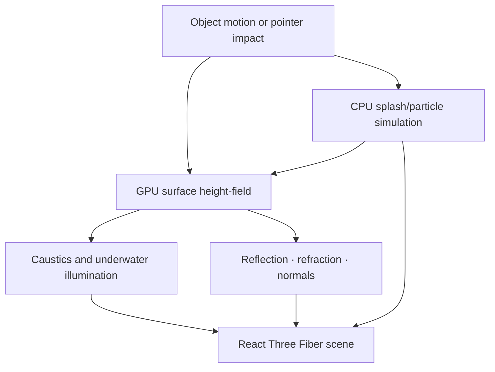

# AQUA · REACTIVE WATER LAB

### Water should react to an event, not just play an animation.

**Interactive surface waves · caustic illumination · splash particles · two-way object interaction**

An object disturbing a pool should not trigger an unrelated decorative particle effect. The surface should displace, waves should propagate, the moving object should respond to the scene, and splashes should remain visually related to the impact.

**Aqua** is a browser water-research application built with React, TypeScript, Three.js and React Three Fiber. Its actual source includes a GPU height-field ripple simulation, water and pool shaders, procedural environment assets, caustic rendering, draggable-object interaction, and a CPU-side MLS-MPM-inspired splash layer.

> **Research status:** source implementation is present. This README is grounded in inspected components, **not** a new executable WebGL2 qualification or a claim that the implementation solves full Navier–Stokes free-surface hydrodynamics. Conservation, coupling accuracy, GPU cost and visual fidelity still require independent tests.

**[Scene orchestration](src/components/WaterScene.tsx)** · **[Surface shaders and geometry](src/components/WaterSurface.tsx)** · **[Pool/environment](src/components/PoolEnvironment.tsx)** · **[Water reference documents](docs/reference/)**

---

## One disturbance, multiple observable consequences



The hybrid architecture uses different representations for different phenomena. A regular height field is suitable for economical surface ripples; active particles give local splashes additional freedom; the shaders then render the disturbed water and its optical interactions.

### What's actually in source

| Layer | Source role |
|---|---|
| **Surface dynamics** | `useWaterSimulation` maintains the ripple field used by the water surface |
| **Particle response** | `useMlsMpm` manages transient impact and splash particles |
| **Interaction** | Draggable sphere displacement, crossing events and user-triggered drops |
| **Rendering** | Water-surface shader from above and below, surface normals and refraction |
| **Lighting** | Caustic field and procedural sky/pool environment |
| **UI** | Controls, event commands and source-state inspection |

This is a hybrid experimental renderer. The existence of a solver labeled MLS-MPM does not independently establish numerically accurate continuum mechanics, mass closure, or published physical calibration.

## Run locally

```bash
npm install
npm run dev
```

Open the local URL printed by Vite. `npm run build` produces the browser build; a successful build alone is not a browser rendering or physics test.

## What would make it a qualified water engine?

A meaningful acceptance program would include source-unmodified Chromium/WebGL2 captures, frame/error telemetry, fixed impact scenarios, wave-speed and damping comparisons, material/energy accounting at the surface-particle boundary, caustic behavior under varying light, and measured GPU frame times on target hardware.

Aqua's most interesting direction is not adding more splash particles. It is making **the same physical disturbance remain coherent across surface geometry, particles and light**.

---

*The earlier autogenerated Lovable README has been replaced with source-specific project documentation; application source is unchanged.*
